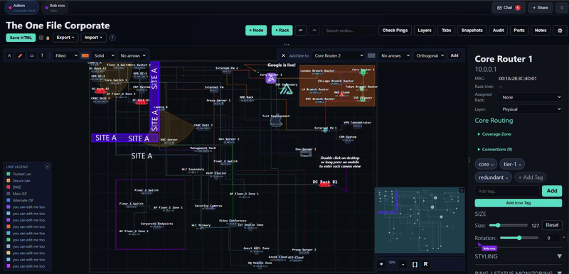

### TheOneFile_Verse

<p align="center">
  
  
  <a href="https://github.com/gelatinescreams/The-One-File/tree/main/theonefile_verse">
  
  </a>
</p>

*As it turns out, there can be more than one (and now in 2D,3D and 4D "VR")*



An easily deployable, Docker based, real time collaboration server with mutli network device discovery, auto service & selfh.st/icons tagging, user accounts, email authentication, SSO, role based access control and more. All configurable via a robust admin panel.

When you're done collaborating, each person can save their own portable copy. That file works exactly like the original TheOneFile: fully offline, self contained, editable anywhere. Import it back into the TheOneFile_Verse anytime to continue collaborating.

**AND/OR**

Rooms auto save your work, no manual exports required. Admins can run as many rooms as needed, a multiOneFileverse of parallel diagrams. Host it privately or open it to the internet (use tons of caution and a secure reverse proxy).

* [TheOneFile_Verse online demo](https://multiverse.therecanonlybe.one/s/0388e827-e374-435a-bea1-8702db394e73)
* *join from different browsers to see real time changes*
* [TheOneFile_Verse landing page](https://multiverse.therecanonlybe.one)
* [TheOneFile_Verse admin demo](https://therecanonlybe.one/theonefile_verse/demo-admin.html)

### Option 1: Easiest

```bash
docker run -d -p 10101:10101 -v theonefile-data:/app/data ghcr.io/gelatinescreams/theonefile_verse:latest
```

Or with docker compose, create a `docker-compose.yml`:

```yaml
services:
  theonefile_verse:
    image: ghcr.io/gelatinescreams/theonefile_verse:latest
    ports:
      - "10101:10101"
    volumes:
      - ./data:/app/data
    restart: unless-stopped
```

Then run:
```bash
docker compose up -d
```

Open `http://localhost:10101`

## Configuration

All settings are configured via the admin panel at `/admin`. On first run, you'll set up an admin account.

### .env

| Variable | Default | Description |
|----------|---------|-------------|
| `PORT` | `10101` | Server port |
| `DATA_DIR` | `./data` | Where settings and room data are stored |
| `REDIS_URL` | | Optional Redis connection for scaling |
| `CORS_ORIGIN` | | Comma separated list of allowed origins |
| `REQUIRE_WS_TOKEN` | `true` | Require WebSocket session tokens. Set to `false` only for trusted local testing |
| `TRUSTED_PROXY_COUNT` | `0` | Number of trusted reverse proxies. Defaults to 0, meaning X Forwarded For is ignored and the real socket address is used. Set this when running behind a reverse proxy so client IPs are read correctly |
| `TRUSTED_PROXIES` | | Comma separated list of trusted proxy IPs. When set, the client IP is the first address that is not in this list |
| `PUBLIC_URL` | | Absolute public origin of this instance, e.g. `https://verse.example.com`. **Wins over `X-Forwarded-Proto` / `X-Forwarded-Host`.** Used to build password reset, magic link, email verification and email change URLs, and as the trusted origin for the same origin (CSRF) check. Set it whenever the browser reaches the instance on an address the server itself cannot see |
| `SKIP_UPDATE` | `false` | `true` stops the Verse fetching the latest app HTML from GitHub and **overwriting `public/theonefile.html`** on every boot. `UPDATE_INTERVAL` only governs the recurring fetch, not the one at startup. Set this on any instance that must stay on a pinned build |
| `UPDATE_INTERVAL` | `0` | Hours between app HTML update checks. `0` disables the recurring timer |
| `REDIS_FANOUT` | `false` | `true` (and `REDIS_URL` set) enables cross process room broadcast fan out over Redis pub/sub. Only needed when more than one Verse process serves the same rooms |
| `ENCRYPTION_KEY` | | 64 hex chars (`openssl rand -hex 32`). Leave unset outside production mode and a random key is generated into `$DATA_DIR/.encryption_key` (mode 0600) and reused, so keep `$DATA_DIR` on a persistent volume. **Turning on production mode while this is unset makes the server refuse to boot.** |
| `WS_IDLE_TIMEOUT` | `120` | Seconds a WebSocket may go silent before it is reaped, clamped to 90-255 (Bun caps it at 255). The browser client sends a `ping` heartbeat well inside this window, so an idle but present tab is never dropped; a half open socket is |
| `MAX_ROOM_CONNECTIONS` | `64` | Maximum simultaneous WebSocket connections to a single room; further joins are refused. `0` disables the cap |
| `DEBUG_OIDC` | `false` | Enable OIDC debug logging (dev only) |
| `SMTP_DEBUG` | `false` | `true` logs the full SMTP conversation. **Development only**, the transcript includes recipient addresses. The AUTH exchange itself is masked either way |
| `SCENE3D_CODE_TTL_DAYS` | `90` | Age at which an orphaned portable 3D scene snapshot (`3d:<code>`) whose room no longer exists is garbage collected. `0`, `off`, `false`, `no`, `disabled` or `never` turns it off; anything unparseable falls back to 90, so a typo cannot silently stop maintenance |

### Instance settings (admin panel)

These live in the database, not the environment, and are changed under **Settings** in the admin
panel.

| Setting | Default | Description |
|---------|---------|-------------|
| `publicUrl` | | The same value as `PUBLIC_URL`. Validated at save time: http/https only, bare origin, no path, query, fragment or `user:pass@`. The environment variable wins when both are set |
| `enable3d` | `true` | Master switch for **Enter 3D**. When off, the 3D script is not injected and every 3D route (`/collab-3d.js`, `/vendor/three/*`, the scene endpoints and the asset store) returns 404 |
| `maxAssetsPerRoomMB` | `200` | Per room ceiling on stored 3D asset bytes (uploaded images and `.glb` models). `0` means unlimited |
| `maxAssetsTotalGB` | `5` | Instance wide ceiling on stored 3D asset bytes. `0` means unlimited |
| `maxRoomSizeMB` | `50` | Per room topology size cap, 1-64 |

Orphaned assets are swept on a 6 hour timer with a 24 hour grace period measured from the moment
they stopped being referenced, and an asset a portable `3d:<code>` snapshot still names is never
reaped. **Sweep assets now** in the admin panel runs it on demand.

#### After a deploy: hard refresh

The collaboration and 3D scripts are versioned by their content, not by a query string, so a
browser tab left open across an upgrade keeps running the old ones. **Reload every open room tab
after deploying.** A stale 3D client that tries to save its scene in the old format is answered
with a conflict, stops saving and shows a red "reload the page" banner rather than overwriting
anyone's work, which is the safe outcome but is also a dead tab until it is reloaded.

#### HTTPS deployments: read this

The server decides whether a request arrived over HTTPS from its *external origin*, and that
is what sets the `Secure` flag on session cookies. Behind a TLS terminating reverse proxy the
request the server actually sees is plain HTTP, so unless you tell it otherwise it will issue
session cookies **without `Secure`**.

Set **one** of the following:

* `PUBLIC_URL=https://verse.example.com`, the explicit, recommended option. It is also
  immune to a forged `X-Forwarded-Host`, which is why it outranks the forwarded headers.
* `TRUSTED_PROXY_COUNT=1` (or `TRUSTED_PROXIES=...`), then, and only then, the server
  believes `X-Forwarded-Proto` / `X-Forwarded-Host`. Use this only if your proxy strips
  client supplied `X-Forwarded-*` headers before adding its own.

Getting this wrong also affects client IP attribution (rate limits and lockouts collapse onto
the proxy's address) and the origin used for password reset / magic link / email verification
URLs.

### TheOneFile_Verse Features
* **Current Version 2.0.2**
  * See [changelog](changelog.md) for the full 2.0.2 and 2.0.1 list of changes

#### Core Collaboration
* Realtime sync via WebSocket
* Field level merging on the server, so two people editing at once never overwrite each other and a stale copy can never undo someone else's work **NEW 2.0.2**
* Undo and redo only revert your own changes **NEW 2.0.2**
* Realtime chat per room with message persistence
* Typing indicators, message replies, @mentions
* Emoji picker and sound notifications
* Real time multi user cursor engine with smooth transitions
* Room based sessions with optional passwords
* Auto destruct rooms (time based or when empty) with countdown display
* Guest access controls per room
* All the functions of TheOneFile_Networkening

#### Enter 3D: a walkable, editable, multiplayer 3D view
* **Enter 3D** button in every room turns the 2D map into a walkable 3D space (Minecraft style controls, Roblox style visuals). Orbit, first person walk, gamepad, and **WebXR VR** on an HTTPS instance
* Everything the 2D map has is rendered and **editable in 3D**: nodes, racks with U mounted devices, wires with the real 2D routing, walls, zones, text, images, per node elevation, per wall height, per edge burial
* **Procedural device models by node type**, server, router, switch, firewall, workstation, laptop, phone, printer, camera, access point, NAS, cloud, plus the node's own web icon extruded from its SVG into real geometry. Both are viewer side toggles
* **Multi select**, shift click, shift drag marquee, `Ctrl/Cmd+A`, group drag and group delete, all as a single undo step
* Minecraft style hotbar and inventory for placing real network elements and furniture
* Live multiplayer: avatars, scene edits broadcast as ops, 3D users show up in the 2D cursor layer as a labelled diamond
* **Per document tab 3D scenes** with optimistic concurrency, so two people with 3D open no longer overwrite each other
* Uploadable images and `.glb` models via a content addressed asset store, with per room and instance wide quotas
* **Portable `3d:<code>`**, the exported One File carries an inert token, and importing it back into a Verse re materialises the 3D world
* **WebXR VR** tested on Quest 3: controller pointing and select, place items, squeeze to teleport, thumbstick movement **NEW 2.0.2**
* Turn the whole feature off instance wide with the `enable3d` admin toggle

#### Full User Account System
* User registration with email verification
* Secure password login with Argon2id hashing
* Two factor authentication (TOTP) with backup codes **NEW 1.7**
* Email change with verification **NEW 1.7**
* Magic link login (passwordless authentication)
* Session management with device tracking
* Multiple active sessions per user
* Account settings: edit your profile, change your password, see your active sessions and sign out one or all of them **NEW 2.0.2**
* Account lockout protection

#### Single Sign On (SSO/OIDC)
* Sign in with Authentik, Google, GitHub, Microsoft, or any OIDC provider
* Link multiple SSO providers to one account
* Auto account linking by email
* Configurable per provider settings
* Full OIDC spec compliance (JWT algorithm mapping, discovery validation, sub claim enforcement)
* Post login redirect persistence across SSO flows
* Secure account linking re verification

#### Real PING
* Overrides built in TheOneFileNetworkening "HTTP PING" with real server side methods
* New probe types: ICMP ping, TCP port check, HTTP/HTTPS, DNS and Multi Probe (all combined)
* Custom user ports
  
#### Network Discovery
* Added "Discover Network Hosts" button to settings panel under Auto Status Checking section (at the bottom)
* Full subnet discovery with CIDR range input and preset common ranges
* Multiple range support
* Port scanning on discovered hosts across 70+ common ports covering infrastructure and self hosted services (more soon)
* Custom user ports
* Export hosts to canvas as nodes and racks with all scanned and edited information
* Admin only mode and public range restrictions available in Admin settings

#### Popular Service + selfh.st/icons Detection
* Reverse DNS hostname resolution
* NetBIOS name resolution (Windows network names)
* mDNS / Avahi multicast DNS resolution
* HTTP server header detection (Server and X Powered By)
* SNMPv2c system name and description queries with configurable community string
* Automatic port to service mapping for 70+ common ports
* Automatic icon detection and assignment for 70+ services via selfh.st icons
* Smart icon tagging via popular ports
* Self hosted media: Plex, Jellyfin, Emby, Sonarr, Radarr, Lidarr, Prowlarr, Bazarr, Overseerr, Tautulli, Ombi, Navidrome, Audiobookshelf, Komga, Jackett, Calibre web
* Automation and IoT: Home Assistant, Node RED, ESPHome, n8n
* +tons more

#### DNS Detection
* Hosts running port 53 are probed further:) to identify the DNS software
* AdGuard Home detected via /control/status endpoint (should work with password protected instances)
* Pi-hole detected via /admin/api.php (v5) and /api/ (v6), (should work with password protected instances)
* Technitium detected via port 5380 presence

#### Docker Detection
* Looks for docker api, dockge, portainer etc
* "Deep Scan" button will popup next to host
* This will scan the host more indepth for containers running though docker IF api is not available
* Docker container names from "Deep Scan" are also added as tags
  
#### Automated Service Tagging
* Services column in Network Discovery table shows tags that will be saved with the host
* Named services (Jellyfin, Grafana, Dockge, etc.) automatic detection
* Generic port detection (Port 3003, Port 8810, etc.)
* Docker container names from "Deep Scan" are also added as tags

#### Email System
* SMTP configuration with TLS/STARTTLS support
* Email verification on signup
* Password reset via email
* Magic link authentication
* Room invitation emails
* Customizable email templates
* Email delivery logging
* Multiple SMTP configurations supported

#### Admin Dashboard
* Full user management (create, edit, deactivate, delete)
* Role based access control (admin, user, guest)
* OIDC provider configuration
* SMTP configuration management
* Email template customization
* Comprehensive audit logging
* Activity logs per room
* Email delivery logs
* System settings management

#### Security & Protection
* **Server side edit authorization**, every room connection resolves a role (owner, admin, editor, guest, viewer) from its session token, and every mutating message is checked against it. A view only room is enforced by the server, not by the client, and the **same gate covers the HTTP write paths** so it cannot be bypassed by posting the payload directly
* **CSRF protection** on every state changing endpoint, with cookie bound tokens (double submit) plus a same origin `Origin`/`Referer` check
* **Subresource Integrity (SRI)** on every script the server injects into a room page, digested from the exact bytes served
* Strict per page Content Security Policy (no external scripts, no WASM, no wildcard origins), the room CSP is what protects users from XSS in user injected content
* Host header poisoning protection: forwarded headers are only believed behind an explicitly trusted proxy, and an operator set `PUBLIC_URL` outranks them
* Bounded request bodies on every route, including chunked uploads that a `Content-Length` check cannot see
* Per room and instance wide storage quotas for uploaded 3D assets, with a grace period garbage collector
* Per room WebSocket connection cap, idle timeout with a server advertised heartbeat, and per message type rate limiting
* AES 256 GCM encryption for all secrets (including TOTP secrets and backup codes)
* PBKDF2 key derivation (600,000 iterations) **Enhanced 1.7**
* Argon2id password hashing
* TOTP two factor authentication (RFC 6238 compliant) **NEW 1.7**
* Secure HTTP only cookies with proper autocomplete attributes
* SameSite cookie policy
* HSTS headers on all responses
* WebSocket session tokens
* WebSocket connection rate limiting per IP
* IP based rate limiting
* Email rate limiting
* Configurable trusted proxy support with environment variable overrides, now also in the admin panel **Enhanced 2.0.2**
* Custom admin path (security through obscurity but not everyone likes the default)
* Constant time token comparison with length padding
* SSRF protection on webhook URLs
* Automatic admin token cleanup
* Full HTML entity escaping on all user generated content
* Shared map text is sanitized and then checked with a real HTML parser before anyone sees it **NEW 2.0.2**
* Network probes require a signed in user **NEW 2.0.2**
* CRLF injection prevention in email headers
* STARTTLS downgrade protection
* File upload size limits
* Generic error messages to prevent user enumeration

#### Responsive & Mobile
* Full responsive design across all pages (landing, auth, admin dashboard)

#### Rate Limiting
* Endpoint rate limiting (configurable window and max attempts)
* Email action rate limiting (signup, password reset, magic link)
* WebSocket token bucket rate limiting per message type

#### Authentication Modes
* Open registration
* Approval required (new accounts wait for an admin to approve them) **NEW 2.0.2**
* Email verification required
* OIDC only (SSO required, admins can still use a password)
* Invite only, backed by a real invite mechanism: `GET`/`POST /api/admin/invites` and `DELETE /api/admin/invites/:id`. Codes are 192 bit, stored hashed, returned in the clear exactly once and consumed atomically. Manage them on the Authentication tab
* Closed (no new registrations)
* Guest room access controls

#### Full Api System [api.md](api.md)
* REST API with authentication
* API key management with read, write (rooms, backups, asset sweep) and admin permissions **Enhanced 2.0.2**
* Webhook notifications for events
* Invite management endpoints, a manual asset sweep, and 3D scene endpoints

#### Multi Process / Cluster Mode (optional)
* Set `REDIS_FANOUT=true` (with `REDIS_URL`) to run more than one Verse process behind a load
  balancer serving the same rooms. Room broadcasts are mirrored over Redis pub/sub, room and
  instance access tokens are shared, and the joiner's user list merges the cluster roster
* Auto destruct is cluster aware: a room is never deleted because one replica happens to be empty,
  and an unknown presence count is treated as "do not delete"
* `GET /api/health` reports `cluster: { redisConnected, fanout, instanceId }` so you can tell one
  replica from another
* Leave it off for a single process deployment, everything is a hard no op and behaviour is
  identical to before

#### Backup & Recovery
* Manual and automatic backups
* Configurable backup intervals
* Backup retention policies
* One click restore

## How It Works
1. Server fetches the latest TheOneFile Networkening HTML from GitHub on startup or upload your own custom template.
2. When users create or join rooms, the HTML is served with collaboration scripts injected.
3. All edits sync in realtime via WebSocket.
4. Data can be saved in the room and can be export into a fully editable and portable version of The One File.
5. Or data can be exported in all popular editing formats.
6. Bring it back later and import the HTML, CSV, JSON, or MD right back into your TheOneFile_Verse room.